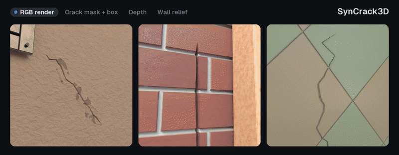

# SynCrack3D

SynCrack3D is a synthetic scene generator that can generate synthetic images of rooms with cracked walls and pixel-exact labels. Each room is built in Blender. Cracks are real displaced geometry in the inspection wall, and every view is rendered with Cycles. For each view you get the RGB image, depth image, a crack mask, instance masks, wall relief map, boxes and COCO annotations. One seed gives one room. The same seed always gives the same room, cameras and lights.



## Layout

```
syncrack3d/        generator: room, inspection wall, materials, cracks, fixtures, cameras, lighting, render
cwg_infinigen/     modified subset of Infinigen (materials, crack injection, labels, sensor model, props)
tools/             export to a training pack, and a label check
isaac_port/        export to Isaac Sim (USD)
eval-syncrack3d/   submodule: evaluation scorers
```

`eval-syncrack3d` is a separate repository, private for now. With access, clone with `git clone --recurse-submodules`, or run `git submodule update --init eval-syncrack3d` in an existing checkout. The generator, export and Isaac port work without it; only the detector diagnostics `isaac_port/room_false_alarms.py` and `tools/render_light_compare.py` use its scorer code.

## Setup

Add the Python environment:

```bash
# generator: Python 3.11 (bpy 4.2 needs it); Blender runs as a Python module
pip install -r requirements.txt
python -m pytest syncrack3d/tests          # 85 tests, a few seconds
```

Run every command from the repository root. Cycles renders on the first GPU it finds (OptiX, CUDA, HIP, Metal, oneAPI) and otherwise on the CPU. Blender prints`Error: Not freed memory blocks` when a run exits; it is harmless.

## 1. Generate rooms

To build one room of a single seed:

```bash
python syncrack3d/build_dataset.py --recipe unified --seeds 0 --output out/rooms
```

To build multiple rooms with one command:

```bash
python syncrack3d/build_dataset.py --recipe unified --seeds 0-99 --output out/rooms --resume
```

The `--resume` flag skips a seed whose scene.json is already in the output folder. That file is written after the room finishes, so the flag is for continuing a batch that stopped partway. Without it, running the same command again rebuilds that seed.

`--recipe unified` is the dataset recipe. Every room is indoors. Its inspection wall has fixtures (doors, windows, vents, pipes, cables, panel seams), at most one prop, and one to three cracks. Each room draws one of 10 materials (plaster, stucco, concrete, brick, tile, large tile, marble, stone block, cobble wall,  
sandstone) and one crack style:

| style | share | cracks |
|---|---|---|
| standard | about 0.72 | hairline to moderate, branched or double-run |
| wide | about 0.17 | open and wide branched cracks |
| crazing | about 0.11 | fine crack networks, on plaster and stucco only |

About half of the cracks start at a corner or edge of a window, door, vent or access panel. Each crack gets two close-up views, and each room also gets wider context views. Lighting varies per room; exposure and white balance per view.

Output per room:

```
out/rooms/seed_<seed>/scene.json             room, wall, material, cracks, fixtures, cameras, lights, settings
out/rooms/seed_<seed>/defect_instances.json  one record per crack: style, width, depth, status
out/rooms/frames/seed_<seed>/Image/          RGB views
out/rooms/frames/seed_<seed>/DefectCrack/    crack coverage per view
out/rooms/frames/seed_<seed>/DefectInstance*/ instance passes, used by the export
out/rooms/frames/seed_<seed>/Depth/          camera-axis depth, uint16 PNG, value * 0.1 mm; 0 = no surface
out/rooms/frames/seed_<seed>/WallRelief/     offset from the wall plane, uint16 PNG, (value - 32768) * 0.01 mm
out/rooms/frames/seed_<seed>/Camera/         intrinsics, pose and the depth encodings
```

Useful options (`python syncrack3d/build_dataset.py --help` lists all):

| option | what it does | example |
|---|---|---|
| `--seeds 0-99` or `--seeds 3,7,12` | which rooms to build | `python syncrack3d/build_dataset.py --recipe unified --seeds 3,7,12 --output out/rooms` |
| `--resume`, `--keep-going` | skip rooms already built; continue past a failed room | `python syncrack3d/build_dataset.py --recipe unified --seeds 0-99 --output out/rooms --resume --keep-going` |
| `--material-category brick` | force one material | `python syncrack3d/build_dataset.py --recipe unified --seeds 0 --output out/rooms --material-category brick` |
| `--crack-style-mix crazing=1` | force one crack style | `python syncrack3d/build_dataset.py --recipe unified --seeds 0 --output out/rooms --crack-style-mix crazing=1` |
| `--crack-style-mix off` | use `--crack-profile`, `--min-defects`, `--max-defects`, `--defect-size-range`, `--crack-width-scale` and `--crack-depth-scale` as given. While a style is drawn, that style replaces these | `python syncrack3d/build_dataset.py --recipe unified --seeds 0 --output out/rooms --crack-style-mix off --crack-profile wide --min-defects 1 --max-defects 1` |
| `--crack-width-scale`, `--crack-depth-scale` | crack width (also changes the labels) and depth. Needs `--crack-style-mix off` with `unified`, or the drawn style replaces them. Width is 0.25 to 4; depth is 0.05 to 2 | `python syncrack3d/build_dataset.py --recipe unified --seeds 0 --output out/rooms --crack-style-mix off --crack-width-scale 2 --crack-depth-scale 0.5` |
| `--crack-junction-fraction 0` | keep cracks away from fixture corners. `unified` uses 0.5 | `python syncrack3d/build_dataset.py --recipe unified --seeds 0 --output out/rooms --crack-junction-fraction 0` |
| `--crack-layered-fraction 0` | share of paint and stucco cracks that get the material-aware edge (lip and chips). 0 leaves a groove only. `unified` uses 0.7. Brick, stone, concrete and tile stay a groove | `python syncrack3d/build_dataset.py --recipe unified --seeds 0 --output out/rooms --crack-layered-fraction 0` |
| `--crack-edge-scale 2` | size of that edge: lip height, chip depth and how far the chips spread. 1 is the dataset size; 0 removes the lip and chips. Range is 0 to 4 | `python syncrack3d/build_dataset.py --recipe unified --seeds 0 --output out/rooms --crack-edge-scale 2` |
| `--resolution`, `--samples` | image size and Cycles samples (`unified`: 640 px, 64 samples) | `python syncrack3d/build_dataset.py --recipe unified --seeds 0 --output out/rooms --resolution 1024 --samples 128` |
| `--no-render --save-blend` | build and save the Blender file without rendering | `python syncrack3d/build_dataset.py --recipe unified --seeds 0 --output out/rooms --no-render --save-blend` |
| `--crack-render pbr` or `albedo` | crack as a normal map only (`pbr`), or as flat colour only (`albedo`). The default is real displacement | `python syncrack3d/build_dataset.py --recipe unified --seeds 0 --output out/rooms --crack-render pbr` |
| `--hide-context all` (or `fixtures`, `props`) | leave fixtures and/or props out of the render; layout and lights unchanged | `python syncrack3d/build_dataset.py --recipe unified --seeds 0 --output out/rooms --hide-context all` |
| `--no-export-depth` | skip the Depth, WallRelief and Camera files | `python syncrack3d/build_dataset.py --recipe unified --seeds 0 --output out/rooms --no-export-depth` |
| `--depth-only` | rebuild the room and render only Depth, WallRelief and Camera, with no RGB or labels. Use a separate output folder | `python syncrack3d/build_dataset.py --recipe unified --seeds 0 --output out/rooms-depth --depth-only` |

## 2. Export a training pack

Generating a room writes the raw render; the training pack turns those renders into the files a detector trains on. To make the train, validation, test split, bounding box, and COCO file: 

```bash
python tools/prepare_defect_annotated_dataset.py -i out/rooms/frames -o out/pack --instance-masks on --with-bboxes --max-negative-fraction 1
python tools/check_instance_contract.py --pack out/pack
```

`-i` is the input folder and `-o` is the output folder. 

`--instance-masks on` gives each crack its own id, from the instance passes and `defect_instances.json`, and stops if either is missing. `off` writes no instance ids and no ignore mask. With `--with-bboxes`, the boxes then come from connected blobs in the coverage pass, so two cracks that touch become one box. The default, `auto`, writes the ids when those files are there.

`--with-bboxes` also writes one box per crack: `bboxes/`, `bboxes_yolo/` and `annotations_coco.json`. Leaving the flag out writes images, masks and the split only. `--max-negative-fraction 1` keeps every view with no crack. `0` drops all of them. The default is `1`. Views that show a crack are always kept. `check_instance_contract.py --pack` checks that the mask, the instance ids and the boxes describe the same cracks. 

`out/pack` holds `images/`, `masks/` (0 background, 60 crack), `ignore_masks/`, `instance_masks/`, `instances/`, `bboxes/`, `bboxes_yolo/`, `annotations_coco.json`, `class_names.txt`, `splits/`, and `depth/`, `wall_relief/` and `cameras/` (not for rooms built with `--no-export-depth`). Splits are by room, so no room is in two splits. The contract check confirms that masks, instances and boxes agree.

## 3. Export to Isaac Sim

Cracks exist as shader displacement at render time, so the Isaac Sim 5 export bakes the wall's colour, roughness, relief and crack coverage and rebuilds the wall as a displaced, labelled USD mesh.

Tested and working with Isaac Sim v5.0.0. 

```bash
# generate a whole room, with no cameras posed at the cracks
python syncrack3d/build_dataset.py --recipe unified --seeds 910004 --output out/rooms --no-render --save-blend
# export to isaacsim USD file
python isaac_port/export_room.py -i out/rooms/seed_910004 -o out/isaac/seed_910004    # add --wall-only for the wall bake alone
# Preview the exported room in Isaac Sim
OMNI_KIT_ACCEPT_EULA=YES path/to/isaac-sim/python isaac_port/compose_room.py out/isaac/seed_910004 --preview
```

`-i` (`--input`) is the room folder (`scene.blend` and `scene.json`) and `-o` (`--output`) is the Isaac export folder. `--wall-only` bakes the wall alone. USD scenes are in metres with Z up. The test wall faces -Y at y = 0, and its meshes are labelled `crack` and `wall`.

## Licence

SynCrack3D is Copyright (c) 2025-2026 Shiven Garg and is released under the BSD 3-Clause License (`LICENSE`). `cwg_infinigen/` is a modified subset of Infinigen (Copyright (c) 2023, Princeton University), also BSD 3-Clause. That notice is kept unchanged in `LICENSE-INFINIGEN` and in the headers of the derived files. Other bundled code keeps the licence file next to it. See `NOTICE`.
